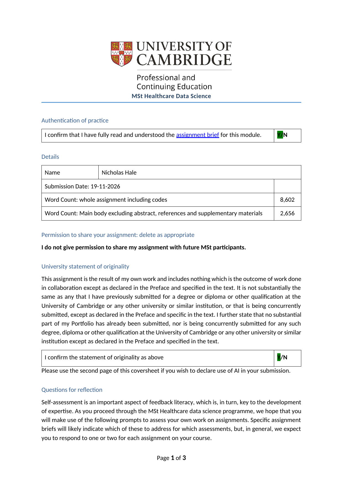
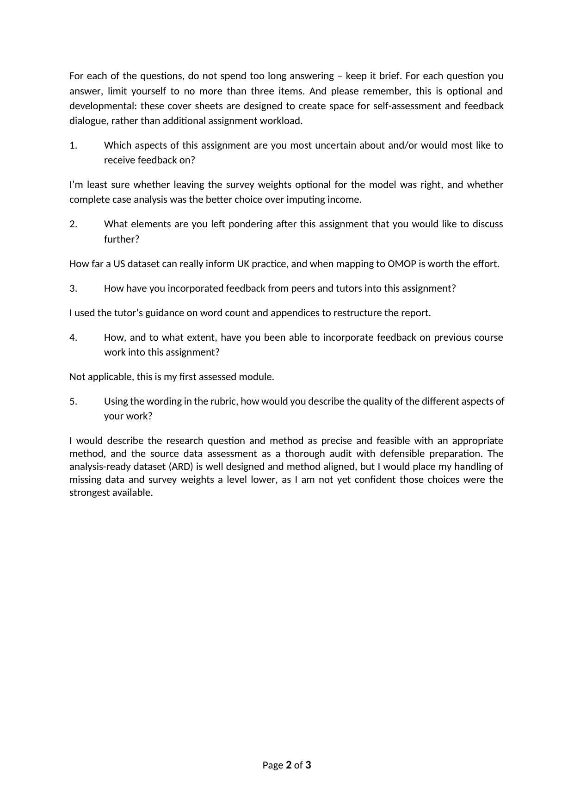
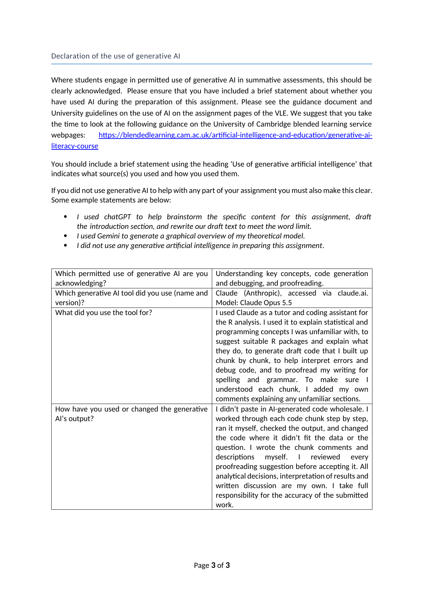

<!-- Environment setup: Packages are installed if missing and loaded with pacman, a package manager aiding reproducibility. tidyverse does most of the data cleaning, haven reads the format NHANES files are published in, and gtsummary makes the table describing the study population. DiagrammeR creates the figure of the data levels, DT shows the wide tables and bslib styles the report. Package versions are listed at the end with sessioninfo.-->

```{r setup, echo = FALSE, message = FALSE}
if (!require("pacman")) install.packages("pacman")
pacman::p_load(tidyverse, haven, gtsummary, bslib, sessioninfo, DT, DiagrammeR)

# printing numbers in the "in line" code with commas, and blanks in tables as "-" instead of N/A
knitr::knit_hooks$set(inline = function(x) prettyNum(x, big.mark = ","))
options(knitr.kable.NA = "-")
```
<!-- Question came from clinical practice, many patients already on antihypertensive treatment still have poorly controlled blood pressure. Factors associated with this could identify groups to target. Search using PubMed, 5 November 2026, published 2015/01/01 to 2026/11/05, in English: (hypertension OR "high blood pressure") AND (uncontrolled OR "blood pressure control" OR "hypertension control") AND (antihypertensive OR treated) AND NHANES. 129 results, most of them US NHANES studies of blood pressure control, showing NHANES should be a viable dataset. The evidence and the reasons for choosing NHANES are set out in the Introduction. Limitations and Bias are also discussed in the later report. -->

<!-- Importing the data: Importing six NHANES August 2021 to August 2023 files straight from the website and joining them into one dataset by SEQN, the participant ID used in NHANES. Then checking the dimensions of the dataset. This is level 0 (raw data): all six files with every variable.-->

```{r level0, echo = FALSE, results = "hide"}
demographics <- read_xpt("https://wwwn.cdc.gov/Nchs/Data/Nhanes/Public/2021/DataFiles/DEMO_L.xpt")
bpquestion <- read_xpt("https://wwwn.cdc.gov/Nchs/Data/Nhanes/Public/2021/DataFiles/BPQ_L.xpt")
bpvalues <- read_xpt("https://wwwn.cdc.gov/Nchs/Data/Nhanes/Public/2021/DataFiles/BPXO_L.xpt")
bodyvalues <- read_xpt("https://wwwn.cdc.gov/Nchs/Data/Nhanes/Public/2021/DataFiles/BMX_L.xpt")
diabetesquestion <- read_xpt("https://wwwn.cdc.gov/Nchs/Data/Nhanes/Public/2021/DataFiles/DIQ_L.xpt")
smokingquestion <- read_xpt("https://wwwn.cdc.gov/Nchs/Data/Nhanes/Public/2021/DataFiles/SMQ_L.xpt")

# joining everything onto the demographics file, as it is the only file with every participant
level0 <- demographics %>%
  left_join(bpquestion, by = "SEQN") %>%
  left_join(bpvalues, by = "SEQN") %>%
  left_join(bodyvalues, by = "SEQN") %>%
  left_join(diabetesquestion, by = "SEQN") %>%
  left_join(smokingquestion, by = "SEQN")

dim(level0)
```
<!-- Feasibility check F1: is the dataset one row per person? Some analyses treat every row as a different person. If someone appears twice, their outcome is counted twice, which makes the sample look bigger than it is and can bias the results. Joining files can also create duplicate rows if an ID appears twice in one file. Checking that every id appears once, and that the join did not add rows. -->

```{r feasibility1, echo = FALSE, results = "hide"}
# rows before and after joining, which should match if the join added nobody
nrow(demographics)
nrow(level0)

# number of different IDs, which should equal the number of rows if everyone appears once
n_distinct(level0$SEQN)
```
<!-- Feasibility check F1 conclusion: demographics has 11,933 rows, the joined data has 11,933 rows and there are 11,933 different IDs. So the joins didn't add anyone and everyone appears once. -->

<!-- First look at the downloaded files: Checking the downloaded files against the NHANES metadata, using str() to list every variable with its type and label. The codebooks (online and linked below) give the meaning of each code. -->
```{r firstlook, echo = FALSE, results = "hide"}
str(demographics)
str(bpquestion)
str(bpvalues)
str(bodyvalues)
str(diabetesquestion)
str(smokingquestion)

# str() output is messy, so this also lists each variable with its NHANES label
data.frame(variable = names(demographics), label = sapply(demographics, attr, "label"), row.names = NULL) 
data.frame(variable = names(bpquestion), label = sapply(bpquestion, attr, "label"), row.names = NULL)
data.frame(variable = names(bpvalues), label = sapply(bpvalues, attr, "label"), row.names = NULL)
data.frame(variable = names(bodyvalues), label = sapply(bodyvalues, attr, "label"), row.names = NULL)
data.frame(variable = names(diabetesquestion), label = sapply(diabetesquestion, attr, "label"), row.names = NULL)
data.frame(variable = names(smokingquestion), label = sapply(smokingquestion, attr, "label"), row.names = NULL)
```
<!-- First look conclusion: all the variables needed are there (blood pressure medication, the three blood pressure readings, BMI, diabetes, smoking and the survey weights). The files cover different numbers of people (7,801 to 11,933), so everything is joined onto demographics, the only file with every participant. categorical answers are stored as number codes, so the codebooks are needed to know what each number means. Each file has its own codebook online, for example the demographics one: "https://wwwn.cdc.gov/Nchs/Data/Nhanes/Public/2021/DataFiles/DEMO_L.htm". There are also far more variables than this question needs, so the next step keeps only the ones being used and renames them. -->

<!-- Renaming the variables: NHANES names like BPQ150 are not self explanatory, so in this step only the columns actually used are kept and given easy to understand names. The lookup table records which NHANES variable has been kept and what each name is now, allowing it to be traced back to the codebook. The survey weight, strata and PSU are kept as they describe how NHANES sampled people, which will be needed for potential statistical analysis. -->

```{r level1, echo = FALSE, results = "hide"}
# NHANES names on the left, readable names on the right combined with "c(...)" and table made with data.frame.
lookup <- data.frame(nhanes_name = c("SEQN", "RIDSTATR", "RIDAGEYR", "RIAGENDR", "RIDRETH3", "INDFMPIR", "RIDEXPRG", "BPQ020", "BPQ150", "BPXOSY1", "BPXOSY2", "BPXOSY3", "BPXODI1", "BPXODI2", "BPXODI3", "BMXBMI", "DIQ010", "SMQ020", "SMQ040", "WTMEC2YR", "SDMVPSU", "SDMVSTRA"),
  new_name = c("id", "examined", "age", "sex", "ethnicity", "income_ratio", "pregnant", "ever_told_high_bp", "bp_meds", "systolic_1", "systolic_2", "systolic_3", "diastolic_1", "diastolic_2", "diastolic_3", "bmi", "told_diabetes", "ever_smoked", "smokes_now", "exam_weight", "psu", "strata"))

# keep only these columns, in the same order, then rename them
level1 <- level0 %>% select(all_of(lookup$nhanes_name))
names(level1) <- lookup$new_name

dim(level1)
```

<!-- Renaming conclusion: 11,933 rows and 22 columns remain, so nobody was lost, only the columns not used. Dropped columns are justified in the introduction and methods. This is level 1; data selected.-->

<!-- Feasibility checks: the question came from clinical practice, these checks make sure the data can actually answer it before building the dataset -->

<!-- Feasibility check F2: NHANES codes "refused" as 7 and "don't know" as 9 in questionnaire answers, so these are numbers sitting in the data rather than blanks. Seeing how many there are in the blood pressure, diabetes and smoking questions.-->

```{r feasibility2, echo = FALSE, results = "hide"}
# how many of each answer, including refused (7), don't know (9) and blank (NA)
table(level1$ever_told_high_bp, useNA = "always")
table(level1$bp_meds, useNA = "always")
table(level1$told_diabetes, useNA = "always")
table(level1$ever_smoked, useNA = "always")
table(level1$smokes_now, useNA = "always")

# adults with no smoking answer, as smoking was only asked of adults
level1 %>% filter(age >= 18) %>% count(is.na(ever_smoked))

# people with any refused or don't know answer, for the checks table
refused <- sum(level1$ever_told_high_bp %in% c(7, 9) | level1$bp_meds %in% c(7, 9) |
               level1$told_diabetes %in% c(7, 9) | level1$ever_smoked %in% c(7, 9))
```

<!-- Feasibility check F2 conclusion: very few refused (7) or don't know (9) answers: 11 for high blood pressure, 4 for medication, 4 for diabetes and 14 for smoking. These become missing in the derived variables, so those people are flagged and left out of the ARD, but the codes are kept in levels 1 and 2 (level 1 only for the blood pressure questions), for transparency and to allow questions to be asked on lack of knowledge or refusal. Code 3 is a real answer: borderline for diabetes (284) and "not at all" for currently smoking (2,053). Most blanks are by design, as the medication question was only asked to people who said a doctor had told them they had high blood pressure and smoking was only asked of adults. The only real gap is 18 adults with no smoking answer. -->

<!-- Feasibility check F3: who was examined, and who is an adult? Blood pressure was only measured in people who attended the examination centre (examined = 2), and the study is about adults, so counting people by both exam status and age 18 or over. -->

```{r feasibility3, echo = FALSE, results = "hide"}
level1 %>% count(examined, age >= 18)

# the examined adults, for the checks table and the later checks
examinedadults <- level1 %>% filter(examined == 2, age >= 18)
```
<!-- Feasibility check F3 conclusion: of 11,933 people, 8,860 were examined and 3,073 only had the home interview. The 3,073 have no blood pressure readings and are removed at level 2. 8,153 people are adults, and 6,337 are both adults and examined. -->

<!-- Feasibility check F4: how common is treated hypertension? ever_told_high_bp stands for whether they were ever told they have high blood pressure, bp_meds stands for currently taking medication for it. -->
```{r feasibility4, echo = FALSE, results = "hide"}
level1 %>% count(ever_told_high_bp, bp_meds)
```
<!-- Feasibility check F4 conclusion: 2,442 people say they take blood pressure medication. The medication question was only asked to people who said yes to being told they had high blood pressure, so everyone who said no is blank for medication. These blanks are by design (skip logic) and not missing data. Only people answering yes (bp_meds == 1) are kept from level 2 onwards, so the don't know answers (9) drop out at level 2 but are kept in level 1. 2,442 treated people (1,927 of them examined) is enough for the question. -->

<!-- Feasibility check F5: who has blood pressure readings? Three readings were taken, but some people have fewer. Counting how many valid systolic readings each person has. -->
```{r feasibility5, echo = FALSE, results = "hide"}
# counting how many systolic readings each person has (0 to 3)
level1 %>%
  mutate(bp_readings = (!is.na(systolic_1)) + (!is.na(systolic_2)) + (!is.na(systolic_3))) %>%
  count(examined, age_group = if_else(age >= 18, "adult", "17 and under"), bp_readings)

# children with no reading, split by under 8 or not, as blood pressure is only measured from age 8
level1 %>%
  filter(examined == 2, is.na(systolic_1), is.na(systolic_2), is.na(systolic_3), age < 18) %>%
  count(under8 = age < 8)

# percentage of examined adults with at least one reading, for the checks table
withreading <- round(mean(!is.na(examinedadults$systolic_1) | !is.na(examinedadults$systolic_2) |
                            !is.na(examinedadults$systolic_3)) * 100, 1)
```
<!-- Feasibility check F5 conclusion: interview-only people (3,073) have no readings, adults and children alike, as they never attended the exam centre. Of the 8,860 examined, 7,478 have all three readings, 28 have two, 12 have one and 1,342 have none; 1,128 of those with none are children, 1,059 of them under 8, as blood pressure is only measured from age 8. Of the 6,337 examined adults, 6,123 (96.6%) have at least one reading; the 214 with none are the true gaps and are removed at level 2. The question is provisionally feasible, based on numbers and the outcome being measured. This is confirmed in Checks and analytical readiness once complete case losses are known. -->

<!-- Level 2 (curated asset), step 1, enrichment: level 2 starts as the examined people on blood pressure medication from level 1, and new variables are created from the raw ones, so level 1 is left unchanged. Blood pressure is the mean of the available readings, a more reliable estimate than a single reading as it smooths out random momentary variations (it does not remove the white coat effect, as all readings are from one visit). Uncontrolled blood pressure is a mean of 140/90 or higher, or 150/90 or higher at age 80 and over (NICE guidelines; age 80 in NHANES means 80 or over). Diabetes is yes or no, with borderline counted as no, as borderline means prediabetes rather than diabetes. Smoking is grouped as never, former or current. Sex and ethnicity are given readable labels instead of number codes, so the curated asset can be used without the codebook (the codes are still in levels 0 and 1). -->
```{r level2enrichment, echo = FALSE, results = "hide"}
# level 2 starts as the examined people on blood pressure medication, so level 1 keeps the codes
level2 <- level1 %>%
  filter(examined == 2, bp_meds == 1) %>%
  mutate(
    # blood pressure: the average of the readings each person has (1, 2 or 3)
    systolic_mean = rowMeans(across(c(systolic_1, systolic_2, systolic_3)), na.rm = TRUE),
    diastolic_mean = rowMeans(across(c(diastolic_1, diastolic_2, diastolic_3)), na.rm = TRUE),
    # uncontrolled (NICE): systolic 140 or more (150 or more at age 80 and over), or diastolic 90 or more
    uncontrolled_bp = if_else(systolic_mean >= if_else(age >= 80, 150, 140) | diastolic_mean >= 90, 1, 0),
    # diabetes: yes is 1, no or borderline is 0, refused or don't know left blank
    diabetes = case_when(told_diabetes == 1 ~ 1,
                         told_diabetes %in% c(2, 3) ~ 0),
    # smoking: never (under 100 cigarettes), former (not now), current (every day or some days)
    smoking_status = case_when(ever_smoked == 2 ~ "never",
                               smokes_now == 3 ~ "former",
                               smokes_now %in% c(1, 2) ~ "current"),
    # words instead of number codes, so level 2 can be read without the codebook
    sex = if_else(sex == 1, "male", "female"),
    ethnicity = case_when(ethnicity == 1 ~ "Mexican American",
                          ethnicity == 2 ~ "Other Hispanic",
                          ethnicity == 3 ~ "Non-Hispanic White",
                          ethnicity == 4 ~ "Non-Hispanic Black",
                          ethnicity == 6 ~ "Non-Hispanic Asian",
                          ethnicity == 7 ~ "Other or multiracial"))
```

<!-- Level 2 (curated asset), step 2 curation: a treated blood pressure dataset. People with no blood pressure reading are removed, as they have no outcome; level 2 is now everyone examined, on medication and with at least one reading. Three decisions someone might make differently are flagged instead of removed (1 = would be excluded, 0 = not excluded by this rule): under 18 (blood pressure judged against centiles, not 140/90), pregnant persons (blood pressure norms change in pregnancy naturally) and incomplete (missing a predictor, as these can't be used in models such as logistic regression). Flagging rather than deleting also keeps these people for future linkage or pooling with other datasets. The variable "in_ard" marks who goes into the ARD: people with none of the three flags. Level 2, with everyone and their flags, is saved as a separate file: "treated_bp.csv", as a potentially commercially viable dataset (in view of pooling). -->
```{r level2curation, echo = FALSE, results = "hide"}
# keeping only people with at least one reading, then flagging the three exclusions (1 = would be excluded)
level2 <- level2 %>%
  filter(!is.na(uncontrolled_bp)) %>%
  mutate(exclude_under_18 = if_else(age < 18, 1, 0),
         # %in% so blanks count as not pregnant
         exclude_pregnant = if_else(pregnant %in% 1, 1, 0),   
         exclude_incomplete = if_else(complete.cases(age, sex, ethnicity, bmi, income_ratio, diabetes, smoking_status), 0, 1),
         in_ard = if_else(exclude_under_18 + exclude_pregnant + exclude_incomplete == 0, 1, 0))

# the people left after each step, for the counts in Figure 1
examinedpeople <- level1 %>% filter(examined == 2)
treated <- examinedpeople %>% filter(bp_meds == 1)
adults <- level2 %>% filter(exclude_under_18 == 0)
notpregnant <- adults %>% filter(exclude_pregnant == 0)
completecases <- notpregnant %>% filter(exclude_incomplete == 0)

# checking the numbers: curated asset size, ARD size, then how many have each flag
nrow(level2)
sum(level2$in_ard)
sum(level2$exclude_under_18)
sum(level2$exclude_pregnant)
sum(level2$exclude_incomplete)

# saving level 2 as a file
write_csv(level2, "treated_bp.csv")
```
<!-- Decision flags conclusion: the curated asset holds 1,857 examined people on blood pressure medication with at least one reading. 4 are under 18, 1 is pregnant and 284 are missing a predictor (mostly income). Four people have two flags, so 285 people are excluded, leaving 1,572 in the ARD. -->

<!-- Quality checks: run on level 2 once it is built, to check the curated asset before the ARD is made. -->

<!-- Quality check Q1: what population does the sample resemble? NHANES does not pick people evenly, so each person has a survey weight, roughly how many Americans they stand for. This shows the ethnicity mix of level 2 twice, side by side: counting each person once (the sample), and counting each person by their weight (an estimate of all treated US adults). The weights can only correct the sample towards the US population, not any other. If the two mixes are close, the sample is essentially a US mix, so users in other countries should compare it with their own population before assuming findings transfer. Ethnicity is used because blood pressure control differs by ethnicity. -->
```{r quality1, echo = FALSE, results = "hide"}
# ethnicity mix in level 2: "sample" counts each person once, "population" counts each person by their survey weight
ethnicitymix <- level2 %>%
  group_by(ethnicity) %>%
  summarise(sample = round(n() / nrow(level2) * 100),
            population = round(sum(exam_weight) / sum(level2$exam_weight) * 100))
ethnicitymix

# the Non-Hispanic White row, for the checks table
white <- filter(ethnicitymix, ethnicity == "Non-Hispanic White")
```
<!-- Quality check Q1 conclusion: the two mixes are close. Non-Hispanic White is 58% of the sample and 61% of the estimated population, Non-Hispanic Black 17% and 16%, and Other Hispanic 9% and 8%. So the sample is a fair picture of treated US adults but not an exact one: Table 3 (unweighted) describes the sample, and anyone estimating for the whole US should use the weights, which are kept in the ARD. The weights only correct towards the US population, so users in other countries should compare this mix with their own population, as findings may not transfer (see the Bias section). -->

<!-- Quality check Q2: how many blood pressure readings does each treated adult have? The outcome uses the average of the readings available. Checking how many people have three, two, one or none, as people with none cannot be given an outcome. -->
```{r quality2, echo = FALSE, results = "hide"}
# counting how many systolic readings each examined adult on medication has (0 to 3)
# this uses level 1, because level 2 only holds people with at least one reading
readings <- level1 %>%
  filter(examined == 2, age >= 18, bp_meds == 1) %>%
  mutate(bp_readings = (!is.na(systolic_1)) + (!is.na(systolic_2)) + (!is.na(systolic_3)))
readings %>% count(bp_readings)

# treated adults with no reading, for the checks table
noreading <- sum(readings$bp_readings == 0)
```
<!-- Quality check Q2 conclusion: 1,845 treated adults have all three readings, 6 have two, 2 have one and 70 have none. So using the average of the readings available only changes things for 8 people, and the 70 with none could not be given an outcome, which is why they were removed when level 2 was built. -->

<!-- Quality check Q3: are the values possible? Before trusting the data, checking level 2 for impossible values (a diastolic of 0, a diastolic at or above the systolic, or a systolic over 250), unusual but possible ones (very high readings or a BMI over 60), and that the categories only contain expected values. -->
```{r quality3, echo = FALSE, results = "hide"}
# range of each measurement in the study population
level2 %>%
  select(systolic_1, systolic_2, systolic_3, diastolic_1, diastolic_2, diastolic_3, bmi, age, income_ratio) %>%
  summary()

# readings that cannot be right
impossible <- level2 %>%
  summarise(dia_zero = sum(diastolic_1 == 0 | diastolic_2 == 0 | diastolic_3 == 0, na.rm = TRUE),
            dia_above_sys = sum(diastolic_1 >= systolic_1 | diastolic_2 >= systolic_2 | diastolic_3 >= systolic_3, na.rm = TRUE),
            sys_over_250 = sum(systolic_1 > 250 | systolic_2 > 250 | systolic_3 > 250, na.rm = TRUE),
            bmi_over_60 = sum(bmi > 60, na.rm = TRUE))
impossible

# checking the categories only contain expected values
level2 %>% count(sex)
level2 %>% count(ethnicity)
level2 %>% count(smoking_status)
level2 %>% count(diabetes)
```
<!-- Quality check Q3 conclusion: no impossible readings (no diastolic of 0, no diastolic at or above systolic, no systolic over 250). Systolic ranges from 65 to 233 mmHg and diastolic from 36 to 138 mmHg, extreme but possible. 7 people have a BMI over 60 (maximum 68.5), also possible, so all are kept. Age stops at 80 and the income ratio at 5 because NHANES top-codes them (80 means 80 or over, 5 means 5 or more), not because of errors. Income is the most often missing (249 people). Categories only contain expected values: two sexes, six ethnic groups, diabetes 0 or 1, and three smoking groups with 7 people missing (including the 4 under 18, who were not asked). -->

<!-- Quality check Q4: are the people left out for missing information different from the people kept? If they are, the ARD could give a slightly wrong picture. Comparing the two groups on uncontrolled blood pressure, age and missing income, whether they might introduce bias.-->
```{r quality4, echo = FALSE, results = "hide"}
# comparing people left out for missing predictors with those kept in the ARD
keptvsleft <- notpregnant %>%
  mutate(kept = in_ard == 1) %>%
  group_by(kept) %>%
  summarise(people = n(),
            uncontrolledpercent = mean(uncontrolled_bp) * 100,
            meanage = mean(age),
            missingincome = sum(is.na(income_ratio)))
keptvsleft
```
<!-- Quality check Q4 conclusion: 280 people were left out for missing information and 1,572 kept. The two groups were similar: uncontrolled blood pressure 31% vs 29%, average age 66 vs 65. Most of those left out (249 of 280) were missing income, so Q5 checks whether income is linked to blood pressure control. If it is, leaving these people out could slightly change the results, and a future analyst could estimate the missing incomes (multiple imputation) to keep everyone in. -->

<!-- Quality check Q5: is income linked to blood pressure control? Comparing the median income of controlled and uncontrolled people in the ARD. If they differ, leaving out the people with missing income (Q4) may slightly change the results. -->
```{r quality5, echo = FALSE, results = "hide"}
# median income for controlled and uncontrolled people among those kept (the same people as the ARD)
incomecheck <- completecases %>%
  group_by(uncontrolled_bp) %>%
  summarise(medianincome = median(income_ratio))
incomecheck
```
<!-- Quality check Q5 conclusion: median income-to-poverty ratio was 2.79 in controlled and 2.11 in uncontrolled people, so lower income goes with uncontrolled blood pressure. Leaving out the 249 people with missing income may therefore slightly change the results, which is noted in Checks and analytical readiness and in Limitations. -->

<!-- Quality check Q6: is missing income linked to uncontrolled blood pressure? Q5 shows income is linked to control, but what decides whether leaving people out biases the odds ratios is whether being missing is linked to the outcome, once the other variables are taken into account. -->
```{r quality6, echo = FALSE, results = "hide"}
# is missing income linked to uncontrolled blood pressure, once the other variables are accounted for?
missingmodel <- glm(is.na(income_ratio) ~ uncontrolled_bp + age + sex + ethnicity + diabetes + smoking_status,
                    family = binomial, data = notpregnant)
summary(missingmodel)

# p value for the outcome, for the checks table
missingp <- round(coef(summary(missingmodel))["uncontrolled_bp", 4], 2)
```
<!-- Quality check Q6 conclusion: missing income is not linked to uncontrolled blood pressure (p = 0.71) once age, sex, ethnicity, diabetes and smoking are accounted for. Only age is linked to missing income (p = 0.03). So complete case odds ratios should not be biased by the missing incomes (Bartlett, Harel and Carpenter, 2015), although this cannot rule out bias from things that were not measured. -->

<!-- Level 3 (ARD): the curated asset with the flags applied (in_ard == 1), keeping only the variables the analysis needs, saved as ard.csv. -->
```{r level3, echo = FALSE, results = "hide"}
# keeping only people with no exclusion flags, then only the variables the analysis needs
level3 <- level2 %>%
  filter(in_ard == 1) %>%
  select(id, age, sex, ethnicity, bmi, income_ratio, diabetes, smoking_status,
         systolic_mean, diastolic_mean, uncontrolled_bp, exam_weight, psu, strata)

# checking the size (should be 1,572 people and 14 variables) and saving level 3 as a file
dim(level3)
write_csv(level3, "ard.csv")

# numbers used in the text, worked out once here
uncontrollednumber <- sum(level3$uncontrolled_bp)
uncontrolledpercent <- round(mean(level3$uncontrolled_bp) * 100)
leftoutnumber <- nrow(notpregnant) - nrow(level3)
leftoutpercent <- round(leftoutnumber / nrow(notpregnant) * 100)

# uncontrolled as Hardy et al. (2025) measured it: treated adults, one 140/90 threshold for all ages, weighted
hardypercent <- level2 %>% filter(age >= 18) %>%
  summarise(uncontrolled = weighted.mean(systolic_mean >= 140 | diastolic_mean >= 90, exam_weight) * 100) %>%
  pull(uncontrolled) %>% round(1)
```

# Coversheet:







# Abstract:

**Background:** Many people treated for high blood pressure do not reach their target, which leaves them at risk of heart attack and stroke. Knowing which groups stay uncontrolled could help target future risk prevention.

**Aim:** To prepare a reusable data asset of people taking blood pressure medication, and an analysis ready dataset (ARD) for a logistic regression of factors associated with uncontrolled blood pressure in treated adults.

**Methods:** Six files from the National Health and Nutrition Examination Survey (NHANES) August 2021 to August 2023 were joined, renamed and checked at each stage. The data was built in four levels, from raw data to the ARD, with the last exclusions flagged rather than deleted. Uncontrolled blood pressure was defined as an average of up to three readings at or above the NICE thresholds. Predictors chosen were age, sex, ethnicity, BMI, income, diabetes and smoking.

**Results:** The curated asset holds `r nrow(level2)` people on treatment. The ARD contains `r nrow(level3)` adults, of whom `r uncontrollednumber` (`r uncontrolledpercent`%) have uncontrolled blood pressure, giving more than 10 events per model parameter. `r leftoutnumber` people (`r leftoutpercent`%) were excluded for missing predictors, mainly income. A data dictionary, phenotype definitions and metadata are provided.

**Conclusion:** The question is feasible for a logistic regression of factors associated with control. The main limitations are single visit readings, self reported data (treatment, diabetes and smoking), missing income (which may not be random), and US data that may not transfer to other countries.

# Introduction:

## Background and literature:

High blood pressure is a leading cause of heart attack and stroke (World Health Organization, 2023). Yet many people on treatment remain uncontrolled: in the 2021 to 2023 NHANES cycle, around 32% of treated adults had blood pressure at or above 140/90 mmHg (Hardy et al., 2025). A PubMed search on 5 November 2026 returned 129 results, mostly US studies of blood pressure control using NHANES data. These studies found lower control in Black adults (Hayes et al., 2022), but unexpected findings for BMI and smoking. People with normal BMI were less often aware of their hypertension, but control among treated adults was broadly similar across BMI (Foti et al., 2022). Current smokers were less likely to be uncontrolled among non-Hispanic White adults, but not among non-Hispanic Black adults (Liu et al., 2017). A broader analysis found lower control in Black, Asian and other Hispanic adults and with lower income, but no link with BMI, smoking or diabetes (Soyombo et al., 2026). However, no study was found modelling these factors in treated adults in the 2021 to 2023 cycle at the UK (National Institute for Health and Care Excellence (NICE), 2019) thresholds of 140/90 mmHg, or 150/90 mmHg from age 80. Soyombo et al. (2026) used 2013 to 2018 data and a 130/80 mmHg threshold, while Hardy et al. (2025) only described control rates, without modelling the factors associated with them. This project prepares a dataset to enable that analysis and future analyses of treated blood pressure.

## Research question and method alignment:

**Research question:** Among adults taking medication for high blood pressure, which factors are associated with uncontrolled blood pressure? Table 1 shows how the data, method and question fit together. This report prepares the dataset. It will not run the final model.

```{r questiontable, echo = FALSE}
# how the question, data and method fit together
question <- tribble(
  ~Part, ~Choice, ~Reason,
  "Data", "NHANES, August 2021 to August 2023 (Centers for Disease Control and Prevention, 2024)",
    "Measured blood pressure; a national community sample; the most recent cycle, free to download",
  "Population", "Adults 18 and over, examined, taking blood pressure medication, with at least one reading, not pregnant (Figure 1)",
    "Treated patients, so control reflects treatment",
  "Outcome", "Uncontrolled (1) or controlled (0): average 140/90 mmHg or higher, or 150/90 mmHg from age 80",
    "UK clinic targets (NICE, 2019)",
  "Predictors", "Age, sex, ethnicity, body mass index, income, diabetes and smoking, chosen in advance",
    "Studied in earlier NHANES work (Ostchega et al., 2018; Hayes et al., 2022; Soyombo et al., 2026); diabetes is common and affects blood pressure; mixed findings for BMI and smoking (Foti et al., 2022; Liu et al., 2017); a link between smoking and lower blood pressure is unlikely to be protective (Linneberg et al., 2015)",
  "Method", "Logistic regression, results as odds ratios",
    "The outcome is yes/no; each factor is adjusted for the others, unlike a chi-squared test, which looks at one factor at a time. Because uncontrolled blood pressure is common (29%), odds ratios will look larger than the true increase in risk; prevalence ratios avoid this (Ostchega et al., 2018)",
  "Data shape", "One row per person, a yes/no outcome, no missing values",
    "What logistic regression needs, with enough uncontrolled cases per parameter (Table 4)",
  "Survey design", "Weights, strata and sampling units kept",
    "Correct for uneven sampling and nonresponse; needed for US population estimates, optional for the association model")

datatable(question, caption = "Table 1: Research question, data and method",
          rownames = FALSE, options = list(dom = "t", ordering = FALSE, pageLength = 7, scrollX = TRUE))
```

# Data asset overview:

This data asset is a curated dataset of people on blood pressure treatment, built from NHANES 2021 to 2023 for reuse by any service or researcher working on treated hypertension. It draws on six NHANES files: demographics and survey design (DEMO_L), the blood pressure questionnaire (BPQ_L) and readings (BPXO_L), body measures (BMX_L), the diabetes (DIQ_L) and smoking (SMQ_L) questionnaires. Figure 1 shows its four levels and the type of question each one suits: level 2 is the curated asset (`treated_bp.csv`) and level 3 is the ARD (`ard.csv`). Level 1 suits questions that include untreated people, such as prevalence. Level 2 suits other questions about treated people, for example imputing the missing incomes. Level 3 is ready for complete case models of these seven predictors.

```{r figure1, echo = FALSE, fig.width = 8, fig.height = 10, fig.cap = "Figure 1: Levels of the data asset and where to stop for each use"}
# writing the text for each box first, with the live counts (\\\\n makes a new line inside a box)
label0 <- paste0("Level 0: raw data\\\\n", prettyNum(nrow(level0), big.mark = ","), " people, all NHANES variables")
label1 <- paste0("Level 1: selected data\\\\n", prettyNum(nrow(level1), big.mark = ","), " people, ", length(lookup$new_name), " variables\\\\nchosen for a treated blood pressure dataset")
label2 <- paste0("Level 2: curated asset\\\\n", prettyNum(nrow(level2), big.mark = ","), " people on treatment, ", sum(level2$uncontrolled_bp), " uncontrolled\\\\nfor any treated blood pressure question")
label3 <- paste0("Level 3: ARD\\\\n", prettyNum(nrow(level3), big.mark = ","), " people, ", sum(level3$uncontrolled_bp), " uncontrolled\\\\nready for logistic regression\\\\nor other analyses needing complete data")

# the side boxes: who was removed or flagged at each step, how many and why
labelremoved <- paste0("Removed\\\\n",
                       "Not examined (", prettyNum(nrow(level1) - nrow(examinedpeople), big.mark = ","), "):\\\\nonly examined people have readings\\\\n",
                       "Not on medication (", prettyNum(nrow(examinedpeople) - nrow(treated), big.mark = ","), "):\\\\nthe question is about treated people\\\\n",
                       "No reading (", nrow(treated) - nrow(level2), "):\\\\nno reading means no outcome")
labelflagged <- paste0("Flagged, kept in level 2\\\\n",
                       "Under 18 (", nrow(level2) - nrow(adults), "):\\\\nchild blood pressure uses centiles\\\\n",
                       "Pregnant (", nrow(adults) - nrow(notpregnant), "):\\\\nblood pressure norms change in pregnancy\\\\n",
                       "Missing a predictor (", nrow(notpregnant) - nrow(completecases), "):\\\\nlogistic regression needs complete rows")

# drawing the figure with grViz, which uses the Graphviz language: boxes are listed first, then the arrows between them
# @@1 to @@6 are placeholders, filled in with the labels listed at the bottom ([1]: label0, and so on)
grViz("
digraph levels {
  // the look of every box and arrow
  node [shape = box, style = filled, fontname = Helvetica, fontsize = 12, width = 4, margin = '0.3,0.1']
  edge [fontname = Helvetica, fontsize = 12]

  // the four levels, down the middle
  raw     [label = '@@1', fillcolor = lightblue]
  clean   [label = '@@2', fillcolor = peachpuff]
  curated [label = '@@3', fillcolor = peachpuff]
  ard     [label = '@@4', fillcolor = palegreen]

  // the two white side boxes: people removed, and people flagged
  removed [label = '@@5', fillcolor = white, margin = '0.4,0.2']
  flagged [label = '@@6', fillcolor = white, margin = '0.4,0.2']
  // invisible points on the main line, where the side arrows branch off
  step1   [shape = point, width = 0.01]
  step2   [shape = point, width = 0.01]

  // keeping each side box level with its branch point
  {rank = same; step1; removed}
  {rank = same; step2; flagged}

  // the arrows: down the middle, and out to the side boxes
  raw -> clean [label = '    keep and rename']
  clean -> step1 [arrowhead = none]
  step1 -> curated
  step1 -> removed
  curated -> step2 [arrowhead = none]
  step2 -> ard
  step2 -> flagged
}

[1]: label0
[2]: label1
[3]: label2
[4]: label3
[5]: labelremoved
[6]: labelflagged
")
```

# Methods:

The question came from clinical practice, and its feasibility was checked before the dataset was built (checks F1 to F5 in Table 4). It was deemed provisionally feasible, confirmed once complete case losses were known (Table 4).

## Source data assessment:

### Data Origin:

NHANES is run by the US National Center for Health Statistics and combines a home interview with a physical examination in a mobile examination centre. Blood pressure was measured three times at one visit, with an automated upper arm monitor after five minutes' rest. This cycle used a redesigned sample and revised procedures after the pandemic. Pooling with the 2017 to March 2020 cycle was considered to increase numbers, but CDC advises caution when comparing across the pandemic gap (National Center for Health Statistics, 2024), and with `r uncontrollednumber` events pooling was unnecessary.

### Structure of the Data:

The six NHANES files cover different numbers of people, from 7,801 for the blood pressure readings to 11,933 for demographics, because not everyone takes every part of the survey. Blood pressure is only measured in people who attend the examination and are aged 8 or over, and some questions are only asked at certain ages. Some blanks are also by design: only people told they had high blood pressure are asked about medication. The files were joined by participant ID onto the demographics file, the only one that includes everyone. No participant was lost, and each person appears once (check F1, Table 4).

### Bias:

Selection and generalisability: NHANES samples groups unevenly and not everyone responds. The survey weights correct for this, but only towards the US population, and are kept for US estimates (check Q1). The sample therefore follows US ethnic categories and proportions, so findings may not transfer to other countries, and small groups such as the `r sum(level3$ethnicity == "Non-Hispanic Asian")` Non-Hispanic Asian participants give less precise estimates. Measurement: all readings come from one visit, and some people read higher in a clinic (the white coat effect), so uncontrolled blood pressure is probably overestimated. UK diagnosis uses home or ambulatory readings for this reason (NICE, 2019). Medication use, diabetes and smoking are self reported: undiagnosed diabetes is counted as no and smoking may be underreported, which would tend to weaken their apparent links with control. Finally, everything was measured at one visit, so a factor cannot be shown to cause uncontrolled blood pressure rather than follow from it.

### Plausibility of values:

No impossible readings were found. Some readings and BMI values were very high but possible, so they were kept, as removing real patients with severe disease would bias the dataset towards healthier people. Ages of 80 and income ratios of 5 are NHANES caps (top coding), not errors.

### Missing data:

```{r missingdata, echo = FALSE, results = "hide"}
# percentage missing for income, BMI and smoking in level 2, for the text below
missingincome <- round(mean(is.na(level2$income_ratio)) * 100)
missingbmi <- round(mean(is.na(level2$bmi)) * 100)
missingsmoking <- round(mean(is.na(level2$smoking_status)) * 100, 1)
```
<!-- Missing data conclusion: income is the most often missing (about 13%, 249 people), then BMI (about 2%, 34 people) and smoking (under 1%, 7 people). Age, sex, ethnicity, diabetes and blood pressure are complete, as the 70 treated adults with no reading were removed when level 2 was built (quality check Q2). -->

In the curated asset (level 2), only three predictors have gaps: income (`r missingincome`%), BMI (`r missingbmi`%) and smoking (`r missingsmoking`%). Blood pressure is complete because the 70 treated adults without a reading were removed. People missing a predictor were flagged and left out of the ARD (level 3; Figure 1), and Table 4 checks the effect (Q4, Q5).

## Decision flags and inclusion criteria:

Under 18s, pregnant participants and people missing a predictor are flagged rather than removed (Figure 1), so they stay in level 2 for other questions and for pooling with other datasets later.


## Phenotype definitions and metadata:

Table 2 gives the source and derivation rule for each phenotype. Control uses the NICE threshold (below 140/90 mmHg, or below 150/90 mmHg from age 80), because the question comes from UK clinical practice and NICE sets an age specific target, whereas US studies apply a single threshold to all ages, usually 140/90 or 130/80 mmHg. Blood pressure is the mean of the available readings, which smooths variation between readings and is the standard NHANES approach. Only 8 treated adults had fewer than three readings (6 with two, 2 with one). Self reported borderline diabetes is coded as no, as borderline means prediabetes rather than diabetes. Smoking status follows the standard CDC definition (Centers for Disease Control and Prevention, no date). In the derived variables, refused and don't know are treated as missing. The original codes are kept in levels 1 and 2.

```{r table2, echo = FALSE}
# the phenotype specification: how each clinical definition is built from NHANES, with its SNOMED code
phenotypes <- data.frame(
  Phenotype = c("Treated hypertension", "Uncontrolled blood pressure", "Diabetes", "Smoking status", "Pregnancy"),
  Source = c("BPQ020, BPQ150", "BPXOSY1-3, BPXODI1-3", "DIQ010", "SMQ020, SMQ040", "RIDEXPRG"),
  Rule = c("Told they have high blood pressure and taking medication", "Average ≥140/90, or ≥150/90 at 80+ (NICE)",
           "Told by a doctor; borderline counted as no", "Never, former or current (CDC)",
           "Pregnant at the exam (flag)"),
  SNOMED = c("Hypertension 38341003", "None; built from systolic 271649006 and diastolic 271650006",
             "Diabetes 73211009", "Never smoked 266919005, ex-smoker 8517006, smoker 77176002",
             "Pregnancy 77386006"))

datatable(phenotypes, caption = "Table 2: Phenotype specification",
          colnames = c("Phenotype", "NHANES source", "Rule", "SNOMED CT"),
          rownames = FALSE, options = list(dom = "t", ordering = FALSE))

# saving the specification as a file so the definitions can be reused
write_csv(phenotypes, "phenotypes.csv")
```

The asset was not mapped to the OMOP common data model: OMOP stores each measurement as a separate row, but this analysis needs one row per person, and OMOP has no standard fields for the survey design variables the asset keeps. Standard codes (SNOMED CT) are recorded in Table 2 and the data dictionary (Table A1) instead, so the asset can be mapped to OMOP later if needed. This follows the FAIR principles (Wilkinson et al., 2016): the metadata makes the asset findable, public data and a rerunnable script make it accessible, standard codes make it interoperable, and the dictionary and phenotypes make it reusable.

# Results: the data product:

The data dictionary (Table A1) gives each ARD variable’s meaning, NHANES source, derivation and SNOMED CT code. The dataset level metadata (Table A2) records the source, size, build date, software, licence and author. Both are in Appendix A and saved with the data as data_dictionary.csv and dataset_metadata.csv.

## Characteristics of the ARD:

<!-- Characteristics of the ARD: who is in the ARD, including how many have uncontrolled blood pressure. Not weighted, so it describes the people in the ARD rather than the US population. -->

```{r table4, echo = FALSE}
# dropping the ID, survey design and blood pressure columns, labelling the outcome, then summarising everyone in the ARD
level3 %>%
  select(-id, -exam_weight, -psu, -strata, -systolic_mean, -diastolic_mean) %>%
  mutate(uncontrolled_bp = if_else(uncontrolled_bp == 1, "Uncontrolled", "Controlled"),
         sex = str_to_sentence(sex), smoking_status = str_to_sentence(smoking_status)) %>%
  tbl_summary(label = list(uncontrolled_bp ~ "Blood pressure", age ~ "Age (years)", sex ~ "Sex", ethnicity ~ "Ethnicity",
                           bmi ~ "BMI (kg/m2)", income_ratio ~ "Income-to-poverty ratio",
                           diabetes ~ "Diabetes", smoking_status ~ "Smoking status")) %>%
  modify_caption("Table 3: Characteristics of the ARD (unweighted)")
```

## Checks and analytical readiness:

```{r table5, echo = FALSE}
# fitting the planned model once, only to check the dataset works with it (results are not interpreted)
testmodel <- glm(uncontrolled_bp ~ age + sex + ethnicity + bmi + income_ratio + diabetes + smoking_status,
                 family = binomial, data = level3)

# each readiness check and whether the ARD passes it
checks <- c("one row per person", "no missing values", "outcome is only 0 or 1", "diabetes is only 0 or 1",
            "smoking has three categories", "everyone is 18 or over", "no pregnant participants",
            "rows match Figure 1", "planned model runs")
passed <- c(n_distinct(level3$id) == nrow(level3),
            sum(is.na(level3)) == 0,
            all(level3$uncontrolled_bp %in% c(0, 1)),
            all(level3$diabetes %in% c(0, 1)),
            n_distinct(level3$smoking_status) == 3,
            all(level3$age >= 18),
            all(completecases$exclude_pregnant == 0),
            nrow(level3) == nrow(completecases),
            testmodel$converged)

# events per parameter, for the write up
parameters <- length(coef(testmodel)) - 1
eventsperparameter <- round(uncontrollednumber / parameters)

# warn when knitting if any readiness check fails
if (!all(passed)) warning("A readiness check failed: see the checks table")

# every check in one table: feasibility (F), quality (Q) and readiness (R)
checktable <- data.frame(
  Check = c(paste0("F", 1:5), paste0("Q", 1:6), "R1 to R9"),
  Question = c("One row per person after joining?", "Refused or don't know answers?", "Who was examined?",
               "Who is treated?", "Who has blood pressure readings?",
               "Does the sample look like the population?", "How many treated adults have no reading?",
               "Are the values possible?", "Are people left out different?", "Is income linked to control?",
               "Is missing income linked to control?",
               paste0("Does the ARD meet every requirement? (", paste(checks, collapse = ", "), ")")),
  Finding = c(paste(prettyNum(n_distinct(level0$SEQN), big.mark = ","), "IDs, all unique"),
              paste(refused, "people"),
              paste(prettyNum(nrow(examinedadults), big.mark = ","), "examined adults"),
              paste(prettyNum(sum(level1$bp_meds == 1, na.rm = TRUE), big.mark = ","), "taking medication (interviewed)"),
              paste0(withreading, "% of examined adults"),
              paste0("Non-Hispanic White ", white$sample, "% unweighted, ", white$population, "% weighted"),
              paste(noreading, "people"),
              paste0(impossible$dia_zero + impossible$dia_above_sys + impossible$sys_over_250,
                     " impossible readings; ", impossible$bmi_over_60, " BMI over 60"),
              paste0(round(keptvsleft$uncontrolledpercent[!keptvsleft$kept]), "% uncontrolled vs ",
                     round(keptvsleft$uncontrolledpercent[keptvsleft$kept]), "% kept"),
              paste("Median income ratio", incomecheck$medianincome[incomecheck$uncontrolled_bp == 1],
                    "uncontrolled vs", incomecheck$medianincome[incomecheck$uncontrolled_bp == 0], "controlled"),
              paste0("No (p = ", missingp, ", adjusted)"),
              # the nine readiness checks share one row: all passed, or the names of any that failed
              if_else(all(passed), "All 9 passed", paste("Failed:", paste(checks[!passed], collapse = ", ")))),
  Decision = c("No duplicates", "Kept as codes, missing in the ARD", "Only examined people have readings",
               "Enough people for the question", "The outcome can be measured",
               "Weights kept", "People with no reading removed", "All values kept",
               "Complete cases kept", "Complete case loss may not be neutral",
               "Complete case odds ratios defensible",
               "Ready for analysis"))

datatable(checktable, caption = "Table 4: Checks run while building the dataset, in pipeline order",
          rownames = FALSE, options = list(dom = "t", ordering = FALSE, pageLength = 12, scrollX = TRUE))
```

Table 4 lists every check run while building the dataset, in pipeline order. Feasibility checks (F) on the raw and selected data, quality checks (Q) on the curated asset (level 2) and readiness checks (R) on the ARD (level 3). The readiness checks show that the ARD meets each requirement set out in the Introduction. The planned model was fitted once only to show that it runs, and its results were not looked at or evaluated.

The model has `r parameters` parameters, because ethnicity and smoking are split into categories. With `r uncontrollednumber` uncontrolled cases, this gives about `r eventsperparameter` events per parameter, well above the rule of ten (Peduzzi et al., 1996).

People left out for missing predictors, mostly income, were similar to those kept (Q4). Income is linked to control (Q5), but whether income is missing is not, once the other variables are accounted for (Q6), so complete case odds ratios should not be biased (Bartlett, Harel and Carpenter, 2015). Level 2 keeps these people, so multiple imputation can still be run as a sensitivity analysis.


# Discussion:

## Replicability, reliability and validity:

Rerunning the pipeline on earlier cycles would need the treated phenotype redefined, as they ask about medication differently (BPQ050A, not BPQ150). For reliability, blood pressure is the average of up to three automated readings taken under a standardised protocol (limits in Bias). To check the outcome was built correctly, it was recalculated as Hardy et al. (2025) did, weighted and with a single 140/90 threshold: `r hardypercent`% of treated adults were uncontrolled, close to their 31.7% in the same cycle, although theirs was also age adjusted. This suggests the readings and treatment status were derived correctly.

## Reproducibility:

The ARD is reproducible: the report rebuilds every level from scratch and the checks in Table 4 rerun at every knit. Reruns depend on the CDC files staying unchanged, so the build date and package versions are recorded (Table A2 and Appendix B). To reproduce it:

1. Install R and RStudio. Any missing packages install automatically.
2. Open the R Markdown file in RStudio, with an internet connection, and click Knit.
3. The six NHANES files download directly from the CDC website, and the checks run automatically.
4. The knit writes the report and five files: `ard.csv`, `treated_bp.csv`, `data_dictionary.csv`, `phenotypes.csv` and `dataset_metadata.csv`.

The code is available on GitHub (https://github.com/NHH29/MSTHDSM1).

## Feasibility verdict:

The dataset's strengths are measured blood pressure, a recent national sample and a pipeline that rebuilds every level from the public files. The question is feasible with NHANES 2021 to 2023 for a logistic regression of associations. The ARD has one row per person, a clearly defined outcome and `r uncontrollednumber` events, about `r eventsperparameter` per model parameter and keeps the survey design variables needed for population estimates. The main uncertainties are not the number of people but the `r leftoutnumber` adults left out of the ARD for missing data, mostly income, and the generalisability limits set out in Bias.

## Limitations and governance:

The `r leftoutnumber` adults with missing data, mostly income, were left out of the ARD, which may not be neutral (Table 4). Only one NHANES cycle was used, and the prescriptions file with drug type and number was not included. Adherence is not recorded, so missed doses cannot be separated from too little treatment or resistant hypertension. Users should therefore treat results as associations in a US sample, use the weights for population estimates, and check the effect of missing income before drawing conclusions.

NHANES 2021 to 2023 was approved by the NCHS Ethics Review Board, and the public use files are deidentified, with ages 80 and over top coded at 80, and freely accessible. No linkage to other data was carried out.

# References:

Bartlett, J.W., Harel, O. and Carpenter, J.R. (2015) 'Asymptotically unbiased estimation of exposure odds ratios in complete records logistic regression', *American Journal of Epidemiology*, 182(8), pp. 730-736. doi:10.1093/aje/kwv114.

Centers for Disease Control and Prevention (no date) *National Health Interview Survey: adult tobacco use glossary*. Available at: https://www.cdc.gov/nchs/nhis/tobacco/tobacco_glossary.htm (Accessed: 11 November 2026).

Centers for Disease Control and Prevention, National Center for Health Statistics (2024) *National Health and Nutrition Examination Survey Data, August 2021-August 2023*. Hyattsville, MD: U.S. Department of Health and Human Services. Available at: https://wwwn.cdc.gov/nchs/nhanes/ (Accessed: 11 November 2026).

Foti, K. et al. (2022) 'BMI and blood pressure control among United States adults with hypertension', *Journal of Hypertension*, 40(4), pp. 741-748. doi:10.1097/HJH.0000000000003072.

Hardy, S.T. et al. (2025) 'Trends in blood pressure control among US adults with hypertension, 2013-2014 to 2021-2023', *American Journal of Hypertension*, 38(2), pp. 120-128. doi:10.1093/ajh/hpae141.

Hayes, D.K. et al. (2022) 'Blood pressure control among non-Hispanic Black adults is lower than non-Hispanic White adults despite similar treatment with antihypertensive medication: NHANES 2013-2018', *American Journal of Hypertension*, 35(6), pp. 514-525. doi:10.1093/ajh/hpac011.

Linneberg, A. et al. (2015) 'Effect of smoking on blood pressure and resting heart rate: a Mendelian randomization meta-analysis in the CARTA Consortium', *Circulation: Cardiovascular Genetics*, 8(6), pp. 832-841. doi:10.1161/CIRCGENETICS.115.001225.

Liu, X. et al. (2017) 'Racial/ethnic disparity in the associations of smoking status with uncontrolled hypertension subtypes among hypertensive subjects', *PLoS ONE*, 12(8), e0182807. doi:10.1371/journal.pone.0182807.

National Center for Health Statistics (2024) *National Health and Nutrition Examination Survey Analytic Guidance and Brief Overview for the August 2021-August 2023 Data Files*. Hyattsville, MD: Centers for Disease Control and Prevention. Available at: https://wwwn.cdc.gov/nchs/nhanes/ContinuousNhanes/OverviewBrief.aspx?Cycle=2021-2023 (Accessed: 18 November 2026).

National Institute for Health and Care Excellence (2019, updated 2023) *Hypertension in adults: diagnosis and management* (NICE guideline NG136). Available at: https://www.nice.org.uk/guidance/ng136 (Accessed: 18 November 2026).

Ostchega, Y. et al. (2018) 'Factors associated with hypertension control in US adults using 2017 ACC/AHA guidelines: National Health and Nutrition Examination Survey 1999-2016', *American Journal of Hypertension*, 31(8), pp. 886-894. doi:10.1093/ajh/hpy047.

Peduzzi, P. et al. (1996) 'A simulation study of the number of events per variable in logistic regression analysis', *Journal of Clinical Epidemiology*, 49(12), pp. 1373-1379. doi:10.1016/S0895-4356(96)00236-3.

Soyombo, E. et al. (2026) 'Factors associated with uncontrolled blood pressure and its association with cardiovascular and all-cause mortality among adults receiving antihypertensive therapy: a retrospective cohort study using NHANES 2013-2018 linked mortality data', *Cureus*, 18, e117143. doi:10.7759/cureus.117143.

Wilkinson, M.D. et al. (2016) 'The FAIR Guiding Principles for scientific data management and stewardship', *Scientific Data*, 3, 160018. doi:10.1038/sdata.2016.18.

World Health Organization (2023) *Global report on hypertension: the race against a silent killer*. Geneva: World Health Organization. Available at: https://www.who.int/publications/i/item/9789240081062 (Accessed: 18 November 2026).

# Appendix A: Metadata:

## Data dictionary:

```{r tableA1, echo = FALSE}
# the data dictionary: what each ARD variable means, where it came from and its standard code
dictionary <- data.frame(
  Variable = c("id", "age", "sex", "ethnicity", "bmi", "income_ratio", "diabetes", "smoking_status",
               "systolic_mean", "diastolic_mean", "uncontrolled_bp", "exam_weight", "psu", "strata"),
  Description = c("Participant ID",
                  "Age in years (80 means 80 or over)",
                  "Male or female",
                  "Race and Hispanic origin, six groups",
                  "Body mass index (kg/m2)",
                  "Family income divided by the poverty line (5 means 5 or more)",
                  "1 if told by a doctor they have diabetes, 0 if not or borderline",
                  "Never, former or current smoker",
                  "Average systolic reading (mmHg), used to build the outcome",
                  "Average diastolic reading (mmHg), used to build the outcome",
                  "Outcome: 1 if uncontrolled at the NICE threshold, 0 if not",
                  "Survey weight, for US estimates, not a predictor",
                  "Survey sampling unit, not a predictor",
                  "Survey stratum, not a predictor"),
  Source = c("SEQN", "RIDAGEYR", "RIAGENDR", "RIDRETH3", "BMXBMI", "INDFMPIR", "DIQ010", "SMQ020, SMQ040",
             "BPXOSY1-3", "BPXODI1-3", "From systolic_mean, diastolic_mean and age",
             "WTMEC2YR", "SDMVPSU", "SDMVSTRA"),
  Concept = c("No standard code", "Age 397669002", "Biological sex 734000001", "Ethnic group 372148003 (non-standard in OMOP)",
              "Body mass index 60621009", "No standard code", "Diabetes 73211009",
              "Never smoked 266919005, ex-smoker 8517006, smoker 77176002",
              "Systolic blood pressure 271649006", "Diastolic blood pressure 271650006",
              "No standard code", "No standard code", "No standard code", "No standard code"))

datatable(dictionary, caption = "Table A1: Data dictionary (variable level metadata) for the analysis ready dataset",
          colnames = c("Variable", "Description", "NHANES source", "SNOMED CT"),
          rownames = FALSE, options = list(pageLength = 14, dom = "ft", ordering = FALSE))

# saving the dictionary as a file for reuse
write_csv(dictionary, "data_dictionary.csv")
```

## Dataset metadata:

```{r tableA2, echo = FALSE}
# the dataset-level metadata, one row per field
metadata <- tribble(
  ~Field,                ~Value,
  "Files created",       "ard.csv, treated_bp.csv, data_dictionary.csv, phenotypes.csv, dataset_metadata.csv",
  "Source",              "NHANES August 2021 to August 2023, National Center for Health Statistics",
  "Each row is",         "One participant",
  "ARD size",            paste(prettyNum(nrow(level3), big.mark = ","), "rows,", ncol(level3), "columns"),
  "Curated asset size",  paste(prettyNum(nrow(level2), big.mark = ","), "rows,", ncol(level2), "columns"),
  "Missing values",      "None in the ARD; the curated asset keeps blanks and exclusion flags",
  "Created",             as.character(Sys.Date()),
  "Software",            R.version.string,
  "Code",                "https://github.com/NHH29/MSTHDSM1",
  "Licence",             "NCHS public-use data: cite NCHS, no attempt to identify participants",
  "Author",              "Nicholas Hale")

datatable(metadata, caption = "Table A2: Dataset-level metadata", rownames = FALSE, options = list(dom = "t", ordering = FALSE, pageLength = 11))

# saving the metadata as a file alongside the data
write_csv(metadata, "dataset_metadata.csv")
```

# Appendix B: R session and package versions:

```{r sessioninfo, echo = FALSE, comment = ""}
sessioninfo::session_info()
```